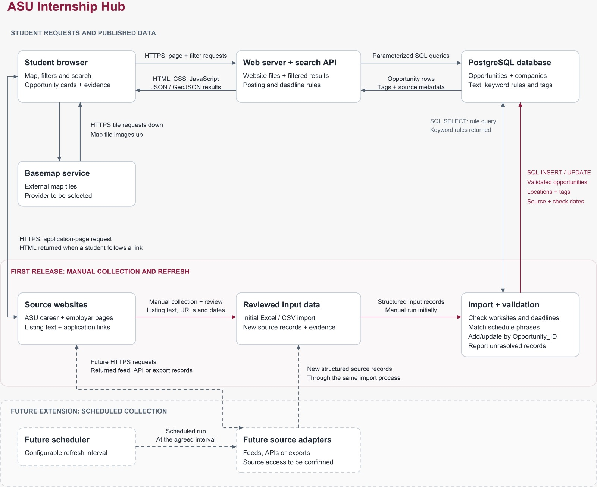
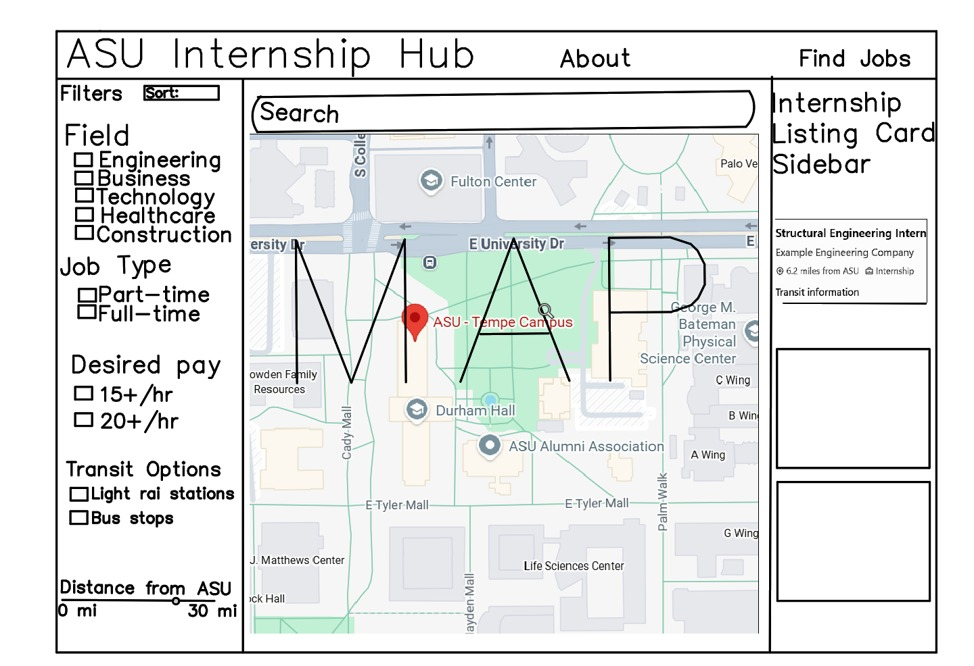

# ASU Internship Hub Project Proposal

**Focus:** Career opportunities near ASU's Tempe campus.

## Team members

| Name | Course level | Role |
| --- | --- | --- |
| Jennifer Lavoe Yawa | GIS 598 | Project Management |
| Yahya Mohamed | GIS 494 | Database Management |
| Ryan Bishop | GIS 494 | Frontend Coordination |
| Jesus Marin Diaz | GIS 598 | Product Management |
| Naji Araiza | GIS 494 | Data Integration Coordination |

## Problem statement

ASU students looking for jobs and internships must compare opportunities across separate career and employer websites. A listing's location, experience requirements, work arrangement, and scheduling expectations can affect whether a student can combine the opportunity with coursework and other responsibilities. These details are difficult to compare when they are scattered across different pages or absent from a listing.

ASU Internship Hub will help students explore individual opportunities on an interactive map near ASU's Tempe campus. The first version will use the team's collected career data, including accounting, corporate finance, insurance, risk management, and financial planning. Students will be able to compare opportunity types, career stages, locations, and stated work arrangements, then follow the source's application instructions. A WebGIS application makes the relationship between an opportunity's worksite and campus visible while keeping job details and filters alongside the map.

The application will also identify scheduling phrases in listing text, such as references to flexible hours or working around coursework. Each resulting tag will retain its supporting phrase and source. The application will describe the evidence available to the student; it will not guarantee that an employer will accommodate an individual class schedule.

## Data and geographic scope

The proposed study area is **30 miles from ASU Memorial Union**, at 301 E Orange St, Tempe, using this reference as the campus anchor of latitude 33.4177504 and longitude -111.9343818.. Distance will mean great-circle distance in miles, rather than driving distance or travel time (as a first pass, it will later evolve considering transportation alternatives). Coordinates will use WGS84 latitude and longitude.

**PostgreSQL is the application's central database.** The backend will use parameterized SQL queries to retrieve opportunities and SQL statements to add or update validated records. PostgreSQL will manage the opportunity, company, listing-text, keyword-rule, and verification data used by the application.

Each mapped feature will represent an **opportunity identified by Opportunity_ID**, connected to an employer through Company_ID (both are the current database tags). Marker symbols and a legend will distinguish internships, other jobs, and opportunities whose type is not stated. A shared worksite may contain multiple opportunities; students must be able to open each individual listing at that location. Internship status and full-time or part-time commitment will be stored separately when the source provides both.

Only records with a confirmed local worksite, suitable source evidence, an eligible posting status, and no passed known deadline will enter the current-opportunity map. A company's office address will not automatically establish the worksite of every job. Records with unresolved placement, term, or availability flags will remain marked for review in PostgreSQL until the team resolves them. Eligibility and deadline checks will also run when results are requested so a listing can expire between updates. Missing deadlines will remain labeled as not stated.

Source material will come from the ASU career listings and employer pages documented in the workbook. The first release will use manual collection and validation followed by controlled SQL updates to PostgreSQL. Automated access to each source is a possible future integration decision. Future source adapters will pass structured records through the same validation process before database updates.

## Functional requirements

| ID | Requirement | Acceptance test |
| --- | --- | --- |
| FR01 | Display an interactive map with zoom, pan, an ASU Tempe reference point, and a marker legend. | Confirm the map loads, navigation works, and the campus point and legend are visible. |
| FR02 | Map eligible opportunities within the selected radius, up to 30 miles, including listings sharing a worksite. | Test inside, boundary, and outside locations. Confirm both listings at a shared location are accessible. |
| FR03 | Show position, employer, location, job requirements, schedule, pay, application details, and source-check date. | Compare listing cards with source records. Missing information displays as “Not stated.” |
| FR04 | Filter by job category, opportunity type, career stage, work commitment, work arrangement, distance, and schedule tags. | Test individual and combined filters. Results satisfy all selected filters; reset restores eligible results. |
| FR05 | Search titles, employers, and listing text, keeping map and list results synchronized. | Search matching and nonmatching terms. Confirm identical opportunity IDs in both views. |
| FR06 | Assign schedule tags using editable phrase rules and display supporting text. | Test explicit, negated, and unrelated phrases. Only valid schedule statements receive flexibility tags. |
| FR07 | Keep work arrangement, work commitment, and schedule flexibility separate. Preserve unknowns and reviewer corrections. | Hybrid or part-time alone does not imply flexibility. Corrections remain after data updates. |
| FR08 | Exclude closed, expired, unconfirmed, or review-pending listings. Keep source-check and import dates separate. | Confirm exclusions and expiry without reimporting. Reimporting does not change source-check dates. |
| FR09 | Allow manual SQL updates to opportunity records in PostgreSQL. | Confirm valid changes appear in the app and invalid or duplicate entries are rejected. |
| FR10 | Provide working application links and clear loading, no-results, and service-error messages. | Check links and simulate loading, no matches, and an unavailable service. |

## Flexibility keyword management

Tags will organize opportunities into four categories: **opportunity type** (internship or other employment), **work commitment** (full-time or part-time), **work arrangement** (on-site, hybrid, or remote), and **schedule flexibility** (flexible hours or scheduling around coursework).

Tags will be assigned using explicit phrases in the listing, with supporting wording available for students to review. Schedule-flexibility tags will remain separate from part-time and hybrid labels because these describe different aspects of an opportunity. Keyword rules will consider context to avoid interpreting phrases such as “flexible spending account” as scheduling flexibility. Missing information will appear as **“Not stated,”** and ambiguous wording will require review.

| Evidence in listing text | Proposed treatment |
| --- | --- |
| Flexible hours, flexible academic schedule, or scheduling around coursework | Schedule flexibility mentioned, with the supporting phrase displayed |
| Part-time or an explicit number of weekly hours | Workload information, stored separately from flexibility |
| Hybrid or remote | Work-location arrangement, stored separately from schedule flexibility |
| Must be flexible to work assigned shifts | Employer availability requirement; no positive schedule-flexibility tag |
| No flexible scheduling, or flexible spending account | No positive schedule-flexibility tag |
| No relevant evidence | Schedule flexibility not stated |

## Architecture

## Wireframe

## Repository link

[ASU Internship Hub](https://github.com/jmarindiaz95/ASU_Internship_Hub)